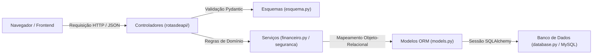

# 🏛️ Arquitetura e Estrutura do Projeto

Este documento detalha o mapa arquitetural do **Sistema de Fluxo de Caixa**, explicando a divisão de responsabilidades, os padrões de projeto adotados e a interação entre os componentes.

---

## 📐 Visão Arquitetural

O projeto foi construído seguindo o padrão de **Separação de Responsabilidades (SoC)** e princípios de **Clean Architecture**, dividindo o fluxo de dados em camadas bem delimitadas:



---

## 📁 Árvore de Diretórios e Papéis

```text
fluxo_caixas/
├── backend/                        # Núcleo da API REST e regras de negócio
│   ├── api.py                      # Ponto de entrada FastAPI, CORS, middlewares e roteamento
│   ├── autenticacao.py             # Emissão, decodificação e validação de tokens JWT
│   ├── configuracao.py             # Carregamento centralizado de variáveis de ambiente
│   ├── dados_sensiveis.py          # Cifragem simétrica Fernet e índice cego HMAC
│   ├── database.py                 # Configuração da engine SQLAlchemy e pooling de conexões
│   ├── esquema.py                  # DTOs e esquemas de validação Pydantic (Input / Output)
│   ├── financeiro.py               # Lógica de cálculo financeiro, saldos e agregações
│   ├── models.py                   # Entidades relacionais mapeadas para o banco de dados
│   ├── rotasdeapi/                 # Controladores modulares organizados por recurso
│   │   ├── usuario.py              # Endpoints de cadastro, login e perfil do usuário
│   │   ├── conta_bancaria.py       # Endpoints de gestão de contas correntes e poupanças
│   │   ├── fluxo_dinheiro.py       # Endpoints de movimentações, receitas, despesas e transferências
│   │   ├── calculo_financeiro.py   # Endpoints de consolidação de relatórios e resumos
│   │   ├── meta_financeira.py      # Endpoints de criação e acompanhamento de metas
│   │   └── readme.md               # Documentação técnica das rotas
│   ├── seguranca/                  # Algoritmos de segurança e credenciais
│   │   ├── seguranca.py            # Hashing e validação de senhas com pwdlib
│   │   └── readme.md               # Documentação das diretrizes de segurança
│   ├── tests/                      # Bateria de testes automatizados com SQLite em memória
│   │   ├── conftest.py             # Fixtures globais, banco isolado e cliente de teste
│   │   ├── test_cadastro_usuario.py# Testes de validação de CPF e cadastro
│   │   ├── test_cors.py            # Testes de origens permitidas e headers CORS
│   │   ├── test_dados_sensiveis.py # Testes de integridade da cifragem Fernet
│   │   ├── test_financeiro.py      # Testes de regras de negócio, saldos e transferências
│   │   ├── test_fluxo_integracao.py# Teste ponta a ponta (E2E) dos fluxos principais
│   │   ├── test_limites_requisicoes.py # Testes de rate limit contra força bruta
│   │   ├── test_metas_relatorios.py# Testes de progresso de metas e cálculos de períodos
│   │   └── test_mysql_concorrencia.py # Testes de concorrência com bloqueio FOR UPDATE (MySQL)
│   └── readme.md                   # Documentação geral do backend
│
├── banco de dados/                 # Camada de persistência e versionamento de banco
│   ├── migrations/                 # Histórico oficial de migrações gerenciado pelo Alembic
│   │   ├── env.py                  # Configuração de contexto e execução das migrações
│   │   └── versions/               # Revisões incrementais ordenadas por dependência
│   ├── alembic.ini                 # Configuração do ambiente Alembic
│   ├── *.sql                       # Scripts DDL legados de referência (não executar em produção)
│   └── readme.md                   # Documentação do modelo e dicionário de dados
│
├── frontend/                       # Camada de apresentação web estática (Vanilla JS)
│   ├── css/
│   │   └── style.css               # Folha de estilo unificada e responsiva
│   ├── js/
│   │   ├── api.js                  # Cliente HTTP reutilizável com fetch e sessionStorage
│   │   ├── cadastro.js             # Lógica e validação da tela de cadastro
│   │   ├── dashboard.js            # Carregamento de dados, modais e métricas no dashboard
│   │   └── login.js                # Tratamento de credenciais e redirecionamento de login
│   ├── cadastro.html               # Página de registro de novo usuário
│   ├── index.html                  # Painel principal autenticado
│   ├── login.html                  # Página de login com e-mail e senha
│   └── README.md                   # Guia de desenvolvimento e consumo do frontend
│
├── scripts/                        # Scripts utilitários de suporte e manutenção
│   └── remover_usuario_teste.py    # Utilitário para expurgo limpo de massa de testes
│
├── .env.example                    # Modelo versionado de variáveis de ambiente
├── main.py                         # Ponto de entrada padrão para execução local
├── pytest.ini                      # Parâmetros e marcadores do runner de testes
└── requirements.txt                # Lista estrita de dependências Python do ecossistema
```

---

## 🔄 Fluxo de Uma Requisição

1. **Cliente:** O navegador dispara uma requisição HTTP através de `api.js` (incluindo o header `Authorization: Bearer <token>` quando autenticado).
2. **CORS & Middlewares:** A API valida a origem do chamador contra a allowlist de desenvolvimento ou produção.
3. **Autenticação:** O injetor de dependência `obter_usuario_logado` valida a assinatura do JWT e extrai o ID do usuário corrente.
4. **Validação do Schema:** O Pydantic valida os tipos, limites de valor, expressões regulares e formatos antes de acionar a lógica interna.
5. **Regras de Negócio (`financeiro.py`):** Validações como verificação de saldo disponível em poupanças/investimentos, tratamento atômico de transferências e consistência de datas são executadas.
6. **Persistência (`models.py` / `database.py`):** A transação SQLAlchemy persiste as alterações no MySQL e efetua o commit atômico.
7. **Resposta:** O objeto serializado é devolvido ao cliente com o código HTTP adequado (200, 201, 204, etc.).

---

## 🔒 Princípios de Segurança Aplicados

- **Isolamento Multiusuário:** Nenhuma rota permite que um usuário informe o ID de outro usuário para acessar ou modificar registros. O ID do usuário é extraído exclusivamente do token criptográfico.
- **Proteção Criptográfica em Repouso:** Dados pessoais identificáveis (CPF e Telefone) são armazenados cifrados com algoritmo Fernet (AES-128-CBC + HMAC-SHA256).
- **Índice Cego (Blind Index):** O campo `cpf_indice` contém um hash HMAC determinístico que permite verificar se um CPF já existe no banco sem a necessidade de descriptografar a tabela inteira.
- **Prevenção de Ataques de Força Bruta:** Rate limiting por endereço IP e por conta impede ataques de dicionário no endpoint de autenticação.
