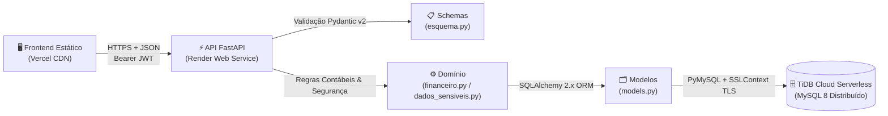

# 🏛️ Arquitetura e Estrutura do Projeto

> 🌐 **App em Produção:** [https://fluxo-caixa-coral-two.vercel.app](https://fluxo-caixa-coral-two.vercel.app)  
> ⚡ **API em Produção:** [https://fluxo-caixa-cuq1.onrender.com](https://fluxo-caixa-cuq1.onrender.com)

Este documento detalha o mapa arquitetural do **Sistema de Fluxo de Caixa**, explicando a topologia de nuvem, a divisão de responsabilidades em camadas, os padrões de projeto adotados e o fluxo completo de uma requisição.

---

## 📐 Topologia de Nuvem e Separação de Responsabilidades (SoC)

O projeto adota uma arquitetura em camadas desacopladas, distribuída em três serviços de nuvem independentes em produção e reproduzível integralmente em ambiente local:



---

## 📁 Árvore Completa de Diretórios e Papéis

```text
fluxo_caixas/
├── backend/                        # Núcleo da API REST e regras de negócio
│   ├── api.py                      # Inicialização FastAPI, CORS estrito por ambiente e rotas / e /health
│   ├── autenticacao.py             # Emissão, decodificação e validação de tokens JWT (OAuth2)
│   ├── configuracao.py             # Carregamento centralizado de variáveis (.env local ou ambiente Cloud)
│   ├── dados_sensiveis.py          # Cifragem simétrica Fernet (AES-128) e Blind Index HMAC-SHA256
│   ├── database.py                 # Engine SQLAlchemy, normalização de URL, SSLContext nativo e pool resiliente
│   ├── esquema.py                  # Contratos de entrada/saída e validações rigorosas com Pydantic v2
│   ├── financeiro.py               # Cálculos contábeis em Decimal, saldos, conciliações e agregações
│   ├── models.py                   # Entidades ORM mapeadas para as tabelas relacionais
│   ├── rotasdeapi/                 # Controladores REST modulares divididos por domínio
│   │   ├── usuario.py              # Cadastro (/usuarios), login (/login), rate limit e perfil (/usuarios/me)
│   │   ├── conta_bancaria.py       # Gestão de contas correntes, poupanças e investimentos
│   │   ├── fluxo_dinheiro.py       # Movimentações, transferências atômicas vinculadas e extrato filtrado
│   │   ├── calculo_financeiro.py   # Consolidação de relatórios periódicos (diário, semanal, mensal, anual)
│   │   ├── meta_financeira.py      # Criação, aportes e conclusão automática de metas financeiras
│   │   └── readme.md               # Documentação técnica detalhada dos endpoints
│   ├── seguranca/                  # Criptografia de credenciais
│   │   ├── seguranca.py            # Hashing e verificação de senhas em tempo constante com pwdlib (Argon2/Bcrypt)
│   │   └── readme.md               # Documentação das camadas de defesa e LGPD
│   ├── tests/                      # Bateria de testes automatizados (65 testes SQLite + 5 MySQL)
│   │   ├── conftest.py             # Fixtures globais, banco SQLite em memória isolado e TestClient
│   │   ├── test_cadastro_usuario.py# Validação de dígitos verificadores de CPF, bloqueio Unicode e telefone
│   │   ├── test_cors.py            # Testes de preflight CORS, origens de produção/dev e validação de APP_ENV
│   │   ├── test_dados_sensiveis.py # Testes de cifragem Fernet, Blind Index HMAC e não-exposição de CPF
│   │   ├── test_financeiro.py      # Precisão Decimal, bloqueio de saldo negativo e transferências vinculadas
│   │   ├── test_fluxo_integracao.py# Fluxo ponta a ponta (E2E) completo do usuário
│   │   ├── test_limites_requisicoes.py # Testes de rate limiting (HTTP 429) e janela de bloqueio
│   │   ├── test_metas_relatorios.py# Testes de metas financeiras e cálculos por período
│   │   ├── test_mysql_concorrencia.py # Testes de concorrência com SELECT ... FOR UPDATE no MySQL
│   │   └── README.md               # Guia da suíte de testes
│   └── readme.md                   # Documentação geral do módulo backend
│
├── banco de dados/                 # Persistência relacional e migrações de schema
│   ├── migrations/                 # Histórico oficial de migrações gerenciado pelo Alembic
│   │   ├── env.py                  # Injeção de sys.path do backend e contexto de migração online/offline
│   │   ├── script.py.mako          # Template padrão de geração de revisões
│   │   ├── versions/               # 8 revisões incrementais que constroem e evoluem o banco
│   │   │   └── README.md           # Árvore de dependências e changelog das migrações
│   │   └── README.md               # Manual operacional do Alembic
│   ├── alembic.ini                 # Configuração principal do Alembic
│   ├── *.sql                       # Scripts DDL históricos de referência (substituídos pelo Alembic)
│   └── readme.md                   # Diagrama ERD e dicionário de dados completo
│
├── frontend/                       # Camada de apresentação web estática (hospedada na Vercel)
│   ├── css/
│   │   └── style.css               # Estilização responsiva, variáveis visuais, tabelas, gráficos e modais
│   ├── js/
│   │   ├── api.js                  # Cliente HTTP com detecção automática HTTPS (Render) vs HTTP (Local)
│   │   ├── cadastro.js             # Máscaras, validação de senha/CPF e registro de novos usuários
│   │   ├── dashboard.js            # Orquestração do painel, gráficos Chart.js, filtros, modais e exportação CSV
│   │   └── login.js                # Fluxo de login OAuth2 e armazenamento de sessão (sessionStorage)
│   ├── cadastro.html               # Tela de criação de conta
│   ├── index.html                  # Painel principal autenticado (Dashboard)
│   ├── login.html                  # Tela de entrada
│   └── README.md                   # Guia da interface frontend e configuração Vercel
│
├── scripts/                        # Utilitários administrativos e de manutenção
│   ├── remover_usuario_teste.py    # Remoção segura e transacional de usuários de teste e seus vínculos
│   └── README.md                   # Instruções de uso seguro dos scripts
│
├── .env.example                    # Modelo versionado de variáveis de ambiente (Local e Cloud)
├── .gitignore                      # Regras de exclusão do Git (.env, venv, caches)
├── .vercelignore                   # Isola o deploy da Vercel apenas para os arquivos estáticos do frontend
├── ESTRUTURA.md                    # Este documento de arquitetura
├── README.md                       # Documentação principal do repositório
├── main.py                         # Ponto de entrada unificado que injeta backend/ no sys.path
├── pytest.ini                      # Configuração de descoberta de testes e marcadores
├── requirements.txt                # Dependências Python do projeto
└── vercel.json                     # Configuração de publicação estática e rewrites na Vercel
```

---

## 🔄 Ciclo de Vida de Uma Requisição em Produção

1. **Acesso Inicial (Vercel):** O usuário acessa `https://fluxo-caixa-coral-two.vercel.app`. O `vercel.json` serve os arquivos estáticos da pasta `frontend/`.
2. **Detecção de Ambiente (`api.js`):** Ao identificar `window.location.protocol === "https:"`, o cliente JavaScript define automaticamente `API_BASE_URL = "https://fluxo-caixa-cuq1.onrender.com"`.
3. **Preflight & CORS (`api.py`):** O navegador verifica a permissão CORS junto ao Render. O middleware valida a origem contra a variável `CORS_ORIGINS` em modo `APP_ENV=production`.
4. **Autenticação e Rate Limit (`autenticacao.py` / `usuario.py`):**
   - No login, o sistema verifica na tabela `tentativas_login` se o IP ou e-mail excedeu 5 falhas nos últimos 15 minutos.
   - Nas rotas autenticadas, o token JWT no header `Authorization: Bearer <token>` é validado e o objeto `Usuario` correspondente é carregado.
5. **Validação de Contrato (`esquema.py`):** O Pydantic v2 higieniza strings, valida formatos de data, valores `Decimal` positivos e categorias permitidas.
6. **Processamento Contábil (`financeiro.py`):**
   - Calcula saldos em tempo real a partir das movimentações.
   - Aplica bloqueio de linha (`with_for_update()`) na conta bancária para evitar condições de corrida em saques ou transferências simultâneas.
7. **Persistência Segura (`database.py` -> TiDB Cloud):** A transação é gravada via conexão criptografada TLS no TiDB Cloud Serverless e confirmada com `db.commit()`.

---

## 🔒 Decisões Arquiteturais de Destaque

- **Normalização Inteligente de `DATABASE_URL`:** A função `normalizar_database_url` em [`backend/database.py`](backend/database.py) converte automaticamente prefixos `mysql://` para `mysql+pymysql://`, substitui bancos de sistema `/sys` por `/test`, escapa senhas com caracteres especiais via `quote_plus` e utiliza `ssl.create_default_context()` nativo do Python para evitar falhas de leitura de arquivo CA em contêineres Linux.
- **Isolamento Estático na Vercel:** O arquivo [`.vercelignore`](.vercelignore) ignora `main.py` e `requirements.txt` durante o build da Vercel, impedindo que a Vercel tente compilar o backend como Serverless Function sem variáveis de ambiente, garantindo que a Vercel sirva exclusivamente o frontend estático com performance máxima de CDN.
