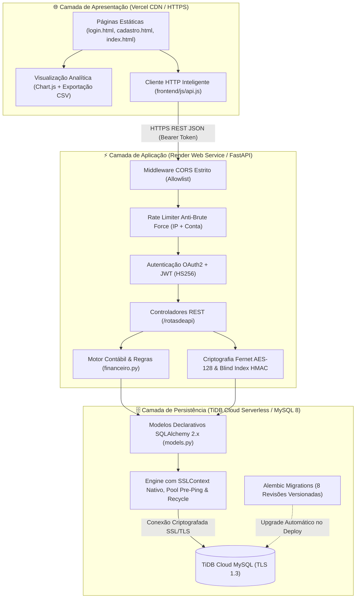

# 💰 Sistema de Fluxo de Caixa — Versão Demo

> 🌐 **Acesse a Aplicação Online (Vercel):** [**https://fluxo-caixa-coral-two.vercel.app**](https://fluxo-caixa-coral-two.vercel.app)  
> ⚡ **API Backend em Produção (Render):** [**https://fluxo-caixa-cuq1.onrender.com**](https://fluxo-caixa-cuq1.onrender.com) | [**Swagger UI (`/docs`)**](https://fluxo-caixa-cuq1.onrender.com/docs) | [**Healthcheck (`/health`)**](https://fluxo-caixa-cuq1.onrender.com/health)

<div align="center">

[](https://fluxo-caixa-coral-two.vercel.app)
[](https://fluxo-caixa-cuq1.onrender.com/health)
[](https://tidbcloud.com)


**Plataforma Full-Stack de gestão e planejamento financeiro pessoal em nuvem, com API REST em FastAPI, banco de dados relacional distribuído (MySQL / TiDB Cloud Serverless), criptografia em repouso (LGPD), interface web responsiva na Vercel e 65 testes automatizados.**

</div>

---

## 📑 Sumário

- [Acesso Rápido à Demo Online](#-acesso-rápido-à-demo-online)
- [Visão Geral](#-visão-geral)
- [Arquitetura Full-Stack (Nuvem & Local)](#-arquitetura-full-stack-nuvem--local)
- [Principais Funcionalidades](#-principais-funcionalidades)
- [Stack Tecnológica](#-stack-tecnológica)
- [Estrutura do Projeto](#-estrutura-do-projeto)
- [Execução Local (Desenvolvimento)](#-execução-local-desenvolvimento)
- [Deploy em Nuvem (Vercel + Render + TiDB Cloud)](#-deploy-em-nuvem-vercel--render--tidb-cloud)
- [Resumo das Rotas da API](#-resumo-das-rotas-da-api)
- [Segurança e Proteção de Dados](#-segurança-e-proteção-de-dados)
- [Testes Automatizados](#-testes-automatizados)
- [Documentações Complementares](#-documentações-complementares)

---

## 🌍 Acesso Rápido à Demo Online

| Ambiente / Serviço | Plataforma | URL Pública |
|---|---|---|
| **Aplicação Web (Frontend)** | Vercel | [https://fluxo-caixa-coral-two.vercel.app](https://fluxo-caixa-coral-two.vercel.app) |
| **Tela de Login** | Vercel | [https://fluxo-caixa-coral-two.vercel.app/login.html](https://fluxo-caixa-coral-two.vercel.app/login.html) |
| **Tela de Cadastro** | Vercel | [https://fluxo-caixa-coral-two.vercel.app/cadastro.html](https://fluxo-caixa-coral-two.vercel.app/cadastro.html) |
| **API REST (Backend)** | Render | [https://fluxo-caixa-cuq1.onrender.com](https://fluxo-caixa-cuq1.onrender.com) |
| **Documentação Interativa (Swagger)** | Render | [https://fluxo-caixa-cuq1.onrender.com/docs](https://fluxo-caixa-cuq1.onrender.com/docs) |
| **Monitoramento de Saúde** | Render | [https://fluxo-caixa-cuq1.onrender.com/health](https://fluxo-caixa-cuq1.onrender.com/health) |

> [!NOTE]
> No plano gratuito do Render, caso a API fique inativa por alguns minutos, a primeira requisição (*cold start*) pode levar cerca de **30 a 50 segundos** para despertar o contêiner. Após acordar, todas as operações respondem instantaneamente.

---

## 🌟 Visão Geral

O **Sistema de Fluxo de Caixa** foi projetado para substituir planilhas manuais por uma arquitetura financeira transacional, auditável e segura. Toda movimentação financeira (receitas, despesas, transferências entre contas e ajustes de conciliação) opera com aritmética exata `Decimal(12, 2)`, garantindo consistência contábil em tempo real tanto localmente quanto na nuvem.

---

## 🏛️ Arquitetura Full-Stack (Nuvem & Local)

A aplicação opera de forma híbrida (detecção automática de ambiente HTTPS em produção ou HTTP em desenvolvimento) com camadas desacopladas:



---

## 🚀 Principais Funcionalidades

### 💼 Backend & Regras de Negócio
- **Autenticação JWT & Rate Limiting:** Emissão de tokens OAuth2 (`Bearer`) com bloqueio progressivo (`HTTP 429`) após 5 tentativas inválidas em 15 minutos.
- **Proteção LGPD em Repouso:** CPF e telefone armazenados cifrados com **Fernet (AES-128-CBC + HMAC-SHA256)** e unicidade garantida por **Blind Index (`cpf_indice`)** sem expor dados sensíveis.
- **Gestão Multi-Contas:** Suporte a contas `corrente`, `poupanca` e `investimento`, com trava contábil que impede saldo negativo em poupanças e investimentos.
- **Transferências Atômicas Vinculadas:** Transferências entre contas geram pares vinculados por `transferencia_id` (UUID) com bloqueio pessimista (`SELECT ... FOR UPDATE`), garantindo que a exclusão de qualquer ponta reverta ambas atomicamente.
- **Conciliação e Balanços Periódicos:** Suporte a lançamentos do tipo `ajuste` (positivos ou negativos) e consolidação de períodos (`diario`, `semanal`, `mensal`, `anual`).
- **Metas Financeiras:** Acompanhamento de objetivos de economia com cálculo de percentual atingido e promoção automática para o status `concluida`.

### 🖥️ Frontend & Experiência do Usuário
- **Dashboard Interativo:** Cards de resumo (Saldo Total, Entradas, Saídas e Investimentos), gráficos dinâmicos de evolução de fluxo e distribuição de despesas por categoria.
- **Filtros Avançados e Exportação CSV:** Filtragem combinada por conta, tipo, categoria e intervalo de datas, além de exportação instantânea do extrato para arquivo `.csv`.
- **Detecção Automática de Ambiente:** O módulo [`frontend/js/api.js`](frontend/js/api.js) identifica automaticamente se está rodando em produção (`https://` na Vercel) ou localmente (`http://127.0.0.1`), direcionando as chamadas sem necessidade de alterar código.

---

## 🛠️ Stack Tecnológica

| Camada | Tecnologia | Papel no Sistema |
|---|---|---|
| **Frontend Hosting** | Vercel | Hospedagem estática global com HTTPS e roteamento via `vercel.json` |
| **Frontend Core** | HTML5, CSS3, JS Vanilla, Chart.js | Interface responsiva, gráficos analíticos e consumo REST |
| **Backend Hosting** | Render | Contêiner Python gerenciado com deploy contínuo integrado ao GitHub |
| **Framework API** | FastAPI + Uvicorn | API REST assíncrona com validação Pydantic v2 e OpenAPI 3.1 |
| **ORM & Migrações** | SQLAlchemy 2.x + Alembic | Persistência relacional, controle transacional e versionamento de schema |
| **Banco em Nuvem** | TiDB Cloud Serverless (MySQL) | Cluster MySQL distribuído na nuvem com conexão TLS/SSL |
| **Segurança** | Cryptography (Fernet) + pwdlib (Argon2) + PyJWT | Cifragem de PII, hashing de senhas de última geração e tokens JWT |
| **Qualidade & Testes** | Pytest + HTTPX | 65 testes unitários e de integração automatizados + 5 testes de concorrência MySQL |

---

## 📁 Estrutura do Projeto

```text
fluxo_caixas/
├── backend/                        # Núcleo da API REST e regras de negócio
│   ├── rotasdeapi/                 # Controladores REST modulares
│   │   ├── usuario.py              # Cadastro, login OAuth2, rate limit e perfil (/usuarios, /login)
│   │   ├── conta_bancaria.py       # CRUD de contas bancárias (/contas-bancarias)
│   │   ├── fluxo_dinheiro.py       # Lançamentos, transferências e extrato (/fluxo-dinheiro)
│   │   ├── calculo_financeiro.py   # Consolidação de períodos (/calculos-financeiros)
│   │   ├── meta_financeira.py      # Metas de economia (/metas-financeiras)
│   │   └── readme.md               # Catálogo técnico de rotas e payloads
│   ├── seguranca/                  # Módulo de hashing de senhas (pwdlib Argon2/Bcrypt)
│   │   ├── seguranca.py            # Funções gerar_hash_senha e verificar_senha
│   │   └── readme.md               # Arquitetura de segurança e criptografia
│   ├── tests/                      # Suíte de testes automatizados (65 testes SQLite + 5 MySQL)
│   │   ├── conftest.py             # Fixtures isoladas em memória
│   │   ├── test_*.py               # Módulos de teste por domínio
│   │   └── README.md               # Guia de execução dos testes
│   ├── api.py                      # Instância FastAPI, política de CORS e healthcheck
│   ├── autenticacao.py             # Emissão e validação de tokens JWT
│   ├── configuracao.py             # Carregamento seguro de variáveis de ambiente
│   ├── dados_sensiveis.py          # Cifragem Fernet e Blind Index HMAC-SHA256
│   ├── database.py                 # Engine SQLAlchemy, normalizador de URL e SSLContext nativo
│   ├── esquema.py                  # Schemas Pydantic v2 (entrada e saída)
│   ├── financeiro.py               # Motor de cálculo de saldos e resumos contábeis
│   ├── models.py                   # Entidades ORM SQLAlchemy
│   └── readme.md                   # Documentação interna do backend
├── banco de dados/                 # Camada de dados e versionamento de schema
│   ├── migrations/                 # Ambiente de migrações Alembic
│   │   ├── versions/               # 8 revisões cronológicas do banco de dados
│   │   │   └── README.md           # Histórico detalhado das revisões
│   │   ├── env.py                  # Contexto de execução Alembic
│   │   └── README.md               # Guia de comandos Alembic
│   ├── alembic.ini                 # Configuração do Alembic
│   ├── *.sql                       # Dumps SQL legados (apenas referência histórica)
│   └── readme.md                   # Modelagem ERD e dicionário de dados
├── frontend/                       # Aplicação Web Estática (publicada na Vercel)
│   ├── css/style.css               # Design system responsivo
│   ├── js/                         # Módulos JavaScript (api.js, login.js, cadastro.js, dashboard.js)
│   ├── index.html                  # Dashboard financeiro principal
│   ├── login.html                  # Página de autenticação
│   ├── cadastro.html               # Página de criação de conta
│   └── README.md                   # Documentação da camada de interface
├── scripts/                        # Utilitários administrativos
│   ├── remover_usuario_teste.py    # Remoção transacional segura de usuários de teste
│   └── README.md                   # Guia de uso dos scripts
├── .env.example                    # Template seguro de variáveis de ambiente
├── .vercelignore                   # Exclusão de arquivos Python no deploy estático da Vercel
├── ESTRUTURA.md                    # Mapa arquitetural detalhado do sistema
├── main.py                         # Ponto de entrada unificado da aplicação
├── pytest.ini                      # Configuração do Pytest
├── requirements.txt                # Dependências Python fixadas
└── vercel.json                     # Regras de roteamento e publicação na Vercel
```

---

## 💻 Execução Local (Desenvolvimento)

### 1. Clonar e Preparar o Ambiente Virtual

```powershell
git clone https://github.com/arthurcamrocha20052008/fluxo_caixa.git
cd fluxo_caixas
python -m venv .venv
.\.venv\Scripts\Activate.ps1
pip install -r requirements.txt
```

### 2. Configurar Variáveis de Ambiente (`.env`)

Copie o arquivo modelo e gere suas chaves locais:

```powershell
Copy-Item .env.example .env

# Gerar JWT_SECRET_KEY
python -c "import secrets; print(secrets.token_urlsafe(48))"

# Gerar CPF_ENCRYPTION_KEY (Fernet)
python -c "from cryptography.fernet import Fernet; print(Fernet.generate_key().decode())"
```

Preencha o `.env` com os dados do seu banco MySQL local (ou TiDB Cloud de desenvolvimento).

### 3. Aplicar Migrações e Subir a API

```powershell
python -m alembic -c "banco de dados/alembic.ini" upgrade head
python main.py
```

A API responderá localmente em `http://127.0.0.1:8000` (Swagger em `http://127.0.0.1:8000/docs`).

### 4. Abrir o Frontend Localmente

- **Via VS Code Live Server:** Clique com o botão direito em `frontend/login.html` → **"Open with Live Server"** (`http://127.0.0.1:5500/frontend/login.html`).
- **Via Python HTTP Server:**
  ```powershell
  python -m http.server 5173 --bind 127.0.0.1 --directory frontend
  ```
  Acesse `http://127.0.0.1:5173/login.html`.

---

## ☁️ Deploy em Nuvem (Vercel + Render + TiDB Cloud)

A arquitetura de produção está configurada para deploy contínuo a partir da branch `main`:

1. **Banco de Dados (TiDB Cloud Serverless):**
   - Cluster MySQL serverless com TLS obrigatório na porta `4000`, utilizando o banco `test`.
   - O módulo [`backend/database.py`](backend/database.py) normaliza automaticamente a `DATABASE_URL` e injeta `ssl.create_default_context()` nativo no `connect_args`.
2. **Backend (Render Web Service):**
   - **Build Command:** `pip install -r requirements.txt`
   - **Start Command:** `python -m alembic -c "banco de dados/alembic.ini" upgrade head && uvicorn main:app --host 0.0.0.0 --port $PORT`
   - **Variáveis de Ambiente:** `APP_ENV=production`, `CORS_ORIGINS=https://fluxo-caixa-coral-two.vercel.app`, `DATABASE_URL`, `JWT_SECRET_KEY`, `CPF_ENCRYPTION_KEY`.
3. **Frontend (Vercel):**
   - Configurado via [`vercel.json`](vercel.json) (`outputDirectory: "frontend"`, `cleanUrls: false`) e [`.vercelignore`](.vercelignore) para publicar apenas os ativos estáticos e redirecionar `/` para `/login.html`.

---

## 📡 Resumo das Rotas da API

| Módulo | Método | Rota | Descrição | Autenticação |
|---|---|---|---|---|
| **Sistema** | `GET` | `/` | Status online da API | Pública |
| **Sistema** | `GET` | `/health` | Healthcheck operacional e ambiente ativo | Pública |
| **Usuários** | `POST` | `/usuarios/` | Cadastro de usuário com validação de CPF e senha forte | Pública |
| **Usuários** | `POST` | `/login` | Autenticação OAuth2 (`username` = e-mail, `password` = senha) | Pública |
| **Usuários** | `POST` | `/usuarios/redefinir-senha` | Redefinição protegida de senha via confirmação de e-mail e CPF | Pública |
| **Usuários** | `GET` | `/usuarios/me` | Retorna perfil do usuário autenticado | Bearer JWT |
| **Contas** | `GET` | `/contas-bancarias/` | Lista contas bancárias e saldos consolidados | Bearer JWT |
| **Contas** | `POST` | `/contas-bancarias/` | Cria conta bancária com lançamento opcional de saldo inicial | Bearer JWT |
| **Contas** | `PUT` | `/contas-bancarias/{id}` | Atualiza dados cadastrais da conta | Bearer JWT |
| **Contas** | `DELETE`| `/contas-bancarias/{id}` | Remove conta bancária sem vínculos pendentes | Bearer JWT |
| **Fluxo** | `GET` | `/fluxo-dinheiro/` | Lista movimentações com filtros de conta, categoria e datas | Bearer JWT |
| **Fluxo** | `POST` | `/fluxo-dinheiro/` | Registra entrada, saída, ajuste ou transferência entre contas | Bearer JWT |
| **Fluxo** | `PUT` | `/fluxo-dinheiro/{id}` | Atualiza movimentação financeira | Bearer JWT |
| **Fluxo** | `DELETE`| `/fluxo-dinheiro/{id}` | Exclui movimentação (ou par atômico de transferência) | Bearer JWT |
| **Cálculos** | `POST` | `/calculos-financeiros/` | Gera e persiste balanço consolidado por período | Bearer JWT |
| **Cálculos** | `GET` | `/calculos-financeiros/` | Histórico de balanços calculados | Bearer JWT |
| **Metas** | `GET` | `/metas-financeiras/` | Lista metas financeiras do usuário | Bearer JWT |
| **Metas** | `POST` | `/metas-financeiras/` | Cria nova meta de economia | Bearer JWT |
| **Metas** | `PUT` | `/metas-financeiras/{id}` | Atualiza progresso da meta e conclui automaticamente ao atingir alvo | Bearer JWT |
| **Metas** | `DELETE`| `/metas-financeiras/{id}` | Exclui meta financeira | Bearer JWT |

---

## 🔒 Segurança e Proteção de Dados

- **Cifragem Simétrica Fernet:** CPF e telefone nunca são gravados em texto claro; são cifrados com AES-128-CBC + HMAC-SHA256 antes do `INSERT`.
- **Blind Index (`cpf_indice`):** Permite validar se um CPF já está cadastrado através de um hash HMAC determinístico com chave derivada, sem descriptografar registros existentes.
- **Hashing Argon2id / Bcrypt (`pwdlib`):** Senhas passam por validação de complexidade (mínimo 8 caracteres, maiúscula, minúscula, número e símbolo) e comparação em tempo constante.
- **Proteção Anti-Enumeração e Rate Limit:** Respostas de login com tempo simulado quando o e-mail não existe e bloqueio `HTTP 429` após 5 falhas em 15 minutos.
- **Isolamento Estrito por Token:** Todas as consultas SQL filtram obrigatoriamente pelo `usuario_id` extraído do token JWT assinado.

---

## 🧪 Testes Automatizados

Execute toda a suíte de testes (65 testes rápidos em banco SQLite em memória isolado):

```powershell
python -m pytest -q
```

Saída esperada:
```text
65 passed, 5 deselected in ~15s
```

Para detalhes completos da cobertura de testes e testes de concorrência MySQL, consulte [`backend/tests/README.md`](backend/tests/README.md).

---

## 📚 Documentações Complementares

- 🏛️ [**Arquitetura e Estrutura Detalhada**](ESTRUTURA.md)
- ⚙️ [**Documentação do Backend**](backend/readme.md)
- 🧭 [**Catálogo Completo de Rotas da API**](backend/rotasdeapi/readme.md)
- 🔐 [**Segurança, Criptografia e LGPD**](backend/seguranca/readme.md)
- 🧪 [**Guia da Suíte de Testes Automatizados**](backend/tests/README.md)
- 🗄️ [**Modelagem e Dicionário do Banco de Dados**](banco%20de%20dados/readme.md)
- 🔄 [**Guia de Migrações Alembic**](banco%20de%20dados/migrations/README.md)
- 📜 [**Histórico de Revisões do Esquema**](banco%20de%20dados/migrations/versions/README.md)
- 🖥️ [**Documentação do Frontend e Deploy Vercel**](frontend/README.md)
- 🛠️ [**Scripts Utilitários e Manutenção**](scripts/README.md)

---

<div align="center">
Desenvolvido com foco em segurança, precisão contábil e arquitetura em nuvem.
</div>
