# 🔐 Segurança, Criptografia e Proteção de Dados (LGPD)

Este módulo implementa as camadas de defesa criptográfica, proteção de credenciais e controle de acesso do **Sistema de Fluxo de Caixa**.

---

## 🎯 Arquitetura de Defesa em Profundidade

```mermaid
flowchart TD
    subgraph S1 ["1. Proteção de Senhas"]
        P["Senha do Usuário"] --> HASH["pwdlib (Argon2id / Bcrypt)"]
        HASH --> DB1[("usuarios.senha_hash")]
    end

    subgraph S2 ["2. Proteção de PII em Repouso (LGPD)"]
        PII["CPF e Telefone"] --> FERNET["Fernet (AES-128-CBC + HMAC-SHA256)"]
        FERNET --> DB2[("usuarios.cpf / usuarios.telefone")]
    end

    subgraph S3 ["3. Unicidade sem Exposição"]
        CPF["CPF Normalizado"] --> BLIND["Blind Index HMAC-SHA256"]
        BLIND --> DB3[("usuarios.cpf_indice UNIQUE")]
    end

    subgraph S4 ["4. Proteção de Autenticação e Rede"]
        LOGIN["POST /login"] --> RL["Rate Limiter (5 tentativas / 15 min)"]
        RL --> TIMING["Mitigação de Timing Attack + HTTP 429"]
    end
```

---

## 🔑 1. Hashing de Senhas (`seguranca.py`)

- **Biblioteca:** `pwdlib` com `PasswordHash.recommended()` (Argon2id como algoritmo principal).
- **Política de Senha Forte (`esquema.py`):** Exige mínimo de 8 caracteres, ao menos uma letra maiúscula, uma minúscula, um dígito numérico e um caractere especial.
- **Comparação em Tempo Constante:** `verificar_senha()` previne ataques de canal lateral (*timing attacks*).

---

## 🛡️ 2. Cifragem Simétrica de Dados Sensíveis (`dados_sensiveis.py`)

Em conformidade com a **LGPD**:
- **Algoritmo:** **Fernet** (`cryptography.fernet`), que combina **AES-128 em modo CBC** com assinatura **HMAC-SHA256** e timestamp de integridade.
- **Chave:** Carregada da variável de ambiente `CPF_ENCRYPTION_KEY` e validada na inicialização da API (`validar_chave_cpf()`).
- **Não-Exposição de CPF:** O CPF é validado no cadastro (incluindo cálculo dos dois dígitos verificadores oficiais e bloqueio de dígitos Unicode não-ASCII), cifrado imediatamente e **jamais** retornado em payloads de resposta da API.

---

## 🔍 3. Índice Cego Determinístico (`cpf_indice`)

Como a cifragem Fernet utiliza um vetor de inicialização (IV) aleatório a cada execução, duas cifragens do mesmo CPF geram textos cifrados diferentes. Para impedir cadastros duplicados sem descriptografar a tabela:
1. Deriva-se uma chave dedicada via SHA-256 a partir de `CPF_ENCRYPTION_KEY`.
2. Calcula-se `HMAC-SHA256(chave_derivada, cpf_11_digitos)`.
3. O digest hexadecimal de 64 caracteres é salvo em `usuarios.cpf_indice` com índice `UNIQUE` no banco de dados.

---

## 🛑 4. Rate Limiting e Anti-Enumeração (`usuario.py`)

- **Rastreamento Duplo:** A tabela `tentativas_login` registra falhas tanto pelo hash SHA-256 do IP de origem quanto pelo hash do e-mail alvo.
- **Janela de Bloqueio:** Após **5 falhas dentro de 15 minutos**, novas tentativas recebem `HTTP 429 Too Many Requests`. Um login bem-sucedido limpa imediatamente o contador.
- **Anti-Enumeração de Contas:** Quando o e-mail informado no login não existe no banco, a API executa uma verificação de senha contra um `_HASH_SENHA_INEXISTENTE` pré-gerado, igualando o tempo de CPU de um usuário real.

---

## 🔒 5. Transporte TLS/SSL em Nuvem

- **Frontend ↔ Backend:** Tráfego 100% HTTPS entre Vercel e Render, com política CORS restrita ao domínio de produção.
- **Backend ↔ Banco de Dados:** Conexão MySQL com o TiDB Cloud Serverless protegida por TLS usando `ssl.create_default_context()` nativo no SQLAlchemy.
