# 🔐 Segurança e Criptografia — Fluxo de Caixa

Este módulo é o pilar de proteção de dados, credenciais e integridade do **Sistema de Fluxo de Caixa**.

---

## 🎯 Pilares de Segurança

A arquitetura de segurança do projeto atua em quatro frentes principais:

```mermaid
flowchart TD
    subgraph S1 ["1. Credenciais"]
        P["Senha em Texto"] --> HASH["Hash com pwdlib (Argon2 / Bcrypt)"]
        HASH --> DB1[("senha_hash no Banco")]
    end

    subgraph S2 ["2. Dados Pessoais (LGPD)"]
        CPF["CPF / Telefone"] --> FERNET["Cifragem Simétrica Fernet (AES-128)"]
        FERNET --> DB2[("Campos Cifrados no Banco")]
    end

    subgraph S3 ["3. Busca sem Exposição"]
        CPF2["CPF"] --> HMAC["HMAC-SHA256 Blind Index"]
        HMAC --> DB3[("cpf_indice Único")]
    end

    subgraph S4 ["4. Acesso & Tráfego"]
        IP["Tentativas de Login"] --> RATE["Rate Limiter (Max 5 / 15 min)"]
        RATE --> STATUS["Bloqueio HTTP 429"]
    end
```

---

## 🔑 1. Armazenamento Seguro de Senhas

### Tecnologia: `pwdlib`
As senhas nunca são salvas em texto puro nem com algoritmos vulneráveis como MD5 ou SHA-1.

- **Biblioteca:** `pwdlib` com perfil `PasswordHash.recommended()` (usa internamente Argon2id e Bcrypt com salts aleatórios por padrão).
- **Funções:**
  - `gerar_hash_senha(senha: str) -> str`: Produz o hash criptográfico seguro armazenado na coluna `usuarios.senha_hash`.
  - `verificar_senha(senha: str, senha_hash: str) -> bool`: Compara a senha enviada na requisição de login com o hash persistido no banco usando comparação em tempo constante para evitar ataques de temporização (timing attacks).

---

## 🛡️ 2. Cifragem de Dados Pessoais em Repouso

Em conformidade com as diretrizes da **LGPD (Lei Geral de Proteção de Dados)**:

### Cifragem com Fernet
- **Campos protegidos:** `usuarios.cpf` e `usuarios.telefone`.
- **Algoritmo:** Fernet (baseado em **AES-128-CBC** com autenticação de mensagem via **HMAC-SHA256** e padding PKCS7).
- **Chave de Cifragem:** Fornecida via variável de ambiente `CPF_ENCRYPTION_KEY`.
- **Comportamento da API:** O CPF **nunca** é devolvido em nenhuma resposta JSON da API. O telefone (opcional) é devolvido descriptografado exclusivamente na rota `/usuarios/me` para o próprio proprietário autenticado.

---

## 🔍 3. Prevenção de Duplicatas com Índice Cego (Blind Index)

Para garantir que nenhum usuário cadastre o mesmo CPF duas vezes sem manter o CPF em texto puro no banco, utilizamos a técnica de **Blind Index**:

1. Uma chave derivada é gerada a partir da `CPF_ENCRYPTION_KEY`.
2. O CPF (normalizado em 11 dígitos numéricos ASCII) é submetido a um hash **HMAC-SHA256**.
3. O valor hexadecimal resultante é armazenado na coluna `usuarios.cpf_indice`, que possui restrição `UNIQUE` no banco de dados.
4. **Vantagem:** O banco de dados valida unicidade instantaneamente sem que ninguém com acesso aos dumps do banco consiga descobrir qual é o CPF original.

---

## 🛑 4. Prevenção de Ataques de Força Bruta (Rate Limiting)

Para proteger o endpoint `POST /login` contra ataques de dicionário automatizados:

- **Armazenamento:** Tabela dedicada `tentativas_login` no banco de dados.
- **Identificadores:** As tentativas são rastreadas tanto por **hash do IP do cliente** (`_chave_cliente_login`) quanto por **hash do e-mail informado** (`_chave_conta_login`).
- **Regra:** Mais de **5 tentativas falhas dentro de 15 minutos** resultam na recusa imediata de novas requisições com código **HTTP 429 (Too Many Requests)**.
- **Proteção contra Enumeração de Usuários:** Quando um usuário não existe, o sistema calcula internamente o hash de uma senha descartável para simular o tempo de resposta exato de um usuário existente, mitigando ataques de análise de tempo.

---

## ⚠️ Boas Práticas e Gestão de Segredos

> [!CAUTION]
> **Backup da chave Fernet:** A perda da variável `CPF_ENCRYPTION_KEY` torna os CPFs e telefones armazenados **irreversíveis**. Mantenha um backup seguro e isolado desta chave.

> [!WARNING]
> **Nunca versão arquivos `.env`:** Segredos reais, credenciais de banco e chaves criptográficas não devem jamais ser commitados no Git. O repositório já inclui `.env` no `.gitignore`.
