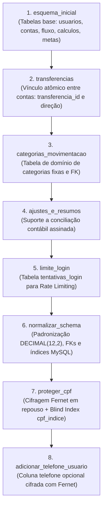

# 📜 Histórico de Revisões do Esquema — Alembic

Este documento registra a linha do tempo e a árvore de dependências das 8 revisões que compõem o esquema relacional do **Sistema de Fluxo de Caixa**.

---

## 🌳 Árvore Linear de Revisões

---

## 📋 Detalhamento Técnico das Revisões

| # | Revisão (`revision`) | Revisão Anterior (`down_revision`) | Descrição e Impacto no Banco |
|---|---|---|---|
| **1** | `esquema_inicial` | `None` | Criação das tabelas principais (`usuarios`, `contas_bancarias`, `fluxo_dinheiro`, `calculos_financeiros`, `metas_financeiras`). |
| **2** | `transferencias` | `esquema_inicial` | Inclusão de `transferencia_id`, `transferencia_direcao` e `conta_destino_id` em `fluxo_dinheiro` para rastreio de transferências entre contas. |
| **3** | `categorias_movimentacao` | `transferencias` | Criação da tabela `categorias_movimentacao` populada com as 16 categorias oficiais e normalização dos registros existentes. |
| **4** | `ajustes_e_resumos` | `categorias_movimentacao` | Inclusão do tipo `ajuste` no enum de movimentações e suporte a valores negativos de conciliação. |
| **5** | `limite_login` | `ajustes_e_resumos` | Criação da tabela `tentativas_login` para controle de força bruta por IP e conta. |
| **6** | `normalizar_schema` | `limite_login` | Alinhamento de tipos `DECIMAL(12,2)`, chaves estrangeiras com `ON DELETE CASCADE` e índices compostos de performance. |
| **7** | `proteger_cpf` | `normalizar_schema` | Migração de segurança LGPD: cifra CPFs com Fernet e adiciona a coluna `cpf_indice` (`UNIQUE`) com HMAC-SHA256. |
| **8** | `adicionar_telefone_usuario` | `proteger_cpf` (`head`) | Adiciona a coluna opcional `telefone` (`VARCHAR(255)`) na tabela `usuarios`, armazenada cifrada com Fernet. |
