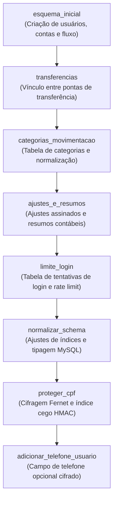

# 📜 Histórico de Revisões do Esquema — Alembic

Este documento mantém o registro histórico e a árvore cronológica de todas as migrações aplicadas ao banco de dados do **Sistema de Fluxo de Caixa**.

---

## 🌳 Árvore de Dependências das Revisões

---

## 📋 Detalhamento de Cada Revisão

| Ordem | Identificador da Revisão | Descrição Técnica e Impacto |
|---|---|---|
| 1 | `esquema_inicial` | Criação das tabelas fundamentais: `usuarios`, `contas_bancarias`, `fluxo_dinheiro`, `calculos_financeiros` e `metas_financeiras`. |
| 2 | `transferencias` | Adição das colunas `transferencia_id`, `transferencia_direcao` e `conta_destino_id` na tabela `fluxo_dinheiro`. |
| 3 | `categorias_movimentacao` | Criação da tabela de categorias fixas e migração de consistência das categorias existentes. |
| 4 | `ajustes_e_resumos` | Habilitação do tipo `ajuste` com valores assinados para conciliação contábil sem distorcer totais de receitas e despesas. |
| 5 | `limite_login` | Criação da tabela `tentativas_login` para rastreamento de IPs e mitigação de ataques de força bruta. |
| 6 | `normalizar_schema` | Padronização de tipos de dados (`VARCHAR`, `DECIMAL(12,2)`) e criação de índices de consulta no MySQL. |
| 7 | `proteger_cpf` | Cifragem de todos os CPFs em repouso com algoritmo Fernet e criação da coluna `cpf_indice` (HMAC-SHA256). |
| 8 | `adicionar_telefone_usuario` | Adição do campo `telefone` na tabela `usuarios` (armazenado cifrado com a mesma chave Fernet). |
