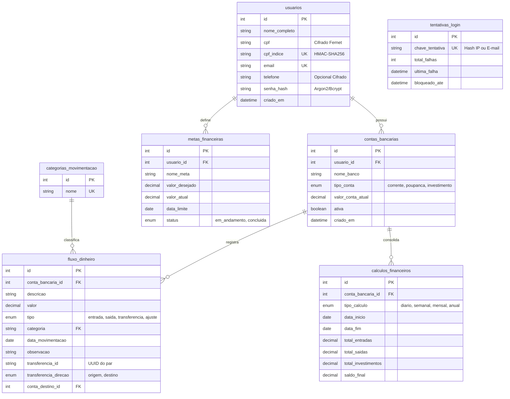

# 🗄️ Modelagem de Banco de Dados — Fluxo de Caixa

Este documento é a referência completa da modelagem relacional, tabelas, relacionamentos e dicionário de dados do **Sistema de Fluxo de Caixa**.

---

## 📊 Diagrama Entidade-Relacionamento (ERD)



---

## 📋 Dicionário de Dados das Tabelas

### 1. `usuarios`
Armazena a identidade dos usuários do sistema.

| Coluna | Tipo | Restrições | Descrição |
|---|---|---|---|
| `id` | `INT` | `PRIMARY KEY, AUTO_INCREMENT` | Identificador único do usuário |
| `nome_completo` | `VARCHAR(150)` | `NOT NULL` | Nome informado no cadastro |
| `cpf` | `VARCHAR(255)` | `NOT NULL, UNIQUE` | CPF cifrado com algoritmo Fernet |
| `cpf_indice` | `VARCHAR(64)` | `NOT NULL, UNIQUE` | Hash cego HMAC-SHA256 para checar duplicatas |
| `email` | `VARCHAR(100)` | `NOT NULL, UNIQUE` | E-mail para login |
| `telefone` | `VARCHAR(255)` | `NULLABLE` | Telefone opcional cifrado com Fernet |
| `senha_hash` | `VARCHAR(255)` | `NOT NULL` | Hash seguro da senha gerado com `pwdlib` |
| `criado_em` | `TIMESTAMP` | `DEFAULT CURRENT_TIMESTAMP` | Data e hora de criação da conta |

### 2. `contas_bancarias`
Representa as contas financeiras geridas por cada usuário.

| Coluna | Tipo | Restrições | Descrição |
|---|---|---|---|
| `id` | `INT` | `PRIMARY KEY, AUTO_INCREMENT` | Identificador único da conta |
| `usuario_id` | `INT` | `FOREIGN KEY (usuarios.id)` | Usuário proprietário da conta |
| `nome_banco` | `VARCHAR(100)` | `NOT NULL` | Nome do banco ou instituição financeira |
| `tipo_conta` | `ENUM` | `'corrente', 'poupanca', 'investimento'` | Modalidade da conta bancária |
| `valor_conta_atual` | `DECIMAL(12,2)` | `DEFAULT 0.00` | Saldo recalculado e consolidado |
| `ativa` | `BOOLEAN` | `DEFAULT TRUE` | Status ativo ou inativo da conta |
| `criado_em` | `TIMESTAMP` | `DEFAULT CURRENT_TIMESTAMP` | Data de criação |

### 3. `fluxo_dinheiro`
Registra cada movimentação, receita, despesa, ajuste ou transferência.

| Coluna | Tipo | Restrições | Descrição |
|---|---|---|---|
| `id` | `INT` | `PRIMARY KEY, AUTO_INCREMENT` | Identificador único da movimentação |
| `conta_bancaria_id`| `INT` | `FOREIGN KEY (contas_bancarias.id)` | Conta de origem da transação |
| `descricao` | `VARCHAR(200)` | `NOT NULL` | Descrição informativa |
| `valor` | `DECIMAL(12,2)` | `NOT NULL` | Valor monetário movimentado |
| `tipo` | `ENUM` | `'entrada', 'saida', 'transferencia', 'ajuste'` | Classificação da operação |
| `categoria` | `VARCHAR(100)` | `NOT NULL` | Categoria normalizada |
| `data_movimentacao`| `DATE` | `NOT NULL` | Data contábil da operação |
| `transferencia_id` | `VARCHAR(36)` | `NULLABLE` | UUID compartilhado pelo par da transferência |
| `transferencia_direcao`| `ENUM` | `'origem', 'destino', NULL` | Sentido do fluxo na conta corrente |
| `conta_destino_id` | `INT` | `NULLABLE, FK (contas_bancarias.id)` | Conta destino em transferências |

---

## ⚙️ Integridade e Versionamento via Alembic

> [!IMPORTANT]
> **Nunca execute arquivos `.sql` brutos em bases de produção!**  
> Os arquivos `.sql` presentes na pasta são dumps legados de referência. A única fonte oficial da verdade do esquema do banco de dados são as **migrações do Alembic** localizadas em [`migrations/`](migrations/).

Para atualizar seu banco com as versões oficiais mais recentes:

```powershell
python -m alembic -c "banco de dados/alembic.ini" upgrade head
```
