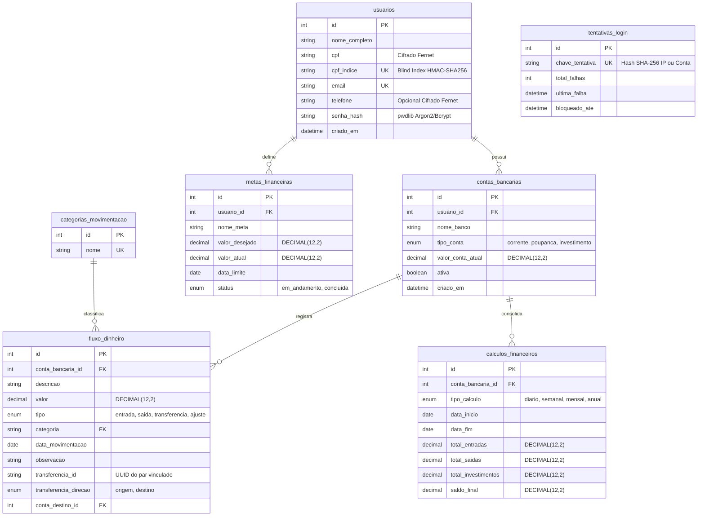

# 🗄️ Modelagem de Banco de Dados — Fluxo de Caixa

Este documento apresenta a modelagem relacional, o diagrama Entidade-Relacionamento (ERD), o dicionário de dados e a arquitetura de conexão com **MySQL 8** (local) e **TiDB Cloud Serverless** (produção em nuvem).

---

## 📊 Diagrama Entidade-Relacionamento (ERD)



---

## 📋 Dicionário de Dados

### 1. `usuarios`
| Coluna | Tipo | Restrições | Descrição |
|---|---|---|---|
| `id` | `INT` | `PK, AUTO_INCREMENT` | Identificador único do usuário |
| `nome_completo` | `VARCHAR(150)` | `NOT NULL` | Nome completo |
| `cpf` | `VARCHAR(255)` | `NOT NULL, UNIQUE` | CPF cifrado com Fernet (AES-128-CBC + HMAC) |
| `cpf_indice` | `VARCHAR(64)` | `NOT NULL, UNIQUE` | Índice cego HMAC-SHA256 para busca de duplicidade |
| `email` | `VARCHAR(100)` | `NOT NULL, UNIQUE` | E-mail de login |
| `telefone` | `VARCHAR(255)` | `NULLABLE` | Telefone opcional cifrado com Fernet |
| `senha_hash` | `VARCHAR(255)` | `NOT NULL` | Hash seguro Argon2id/Bcrypt |
| `criado_em` | `DATETIME` | `DEFAULT CURRENT_TIMESTAMP` | Data/hora de cadastro |

### 2. `contas_bancarias`
| Coluna | Tipo | Restrições | Descrição |
|---|---|---|---|
| `id` | `INT` | `PK, AUTO_INCREMENT` | Identificador único da conta |
| `usuario_id` | `INT` | `FK (usuarios.id) ON DELETE CASCADE` | Proprietário da conta |
| `nome_banco` | `VARCHAR(100)` | `NOT NULL` | Nome da instituição financeira |
| `tipo_conta` | `ENUM` | `'corrente', 'poupanca', 'investimento'` | Modalidade da conta |
| `valor_conta_atual` | `DECIMAL(12,2)` | `DEFAULT 0.00` | Saldo consolidado pelas movimentações |
| `ativa` | `BOOLEAN` | `DEFAULT TRUE` | Indica se a conta está ativa |
| `criado_em` | `DATETIME` | `DEFAULT CURRENT_TIMESTAMP` | Data de abertura no sistema |

### 3. `fluxo_dinheiro`
| Coluna | Tipo | Restrições | Descrição |
|---|---|---|---|
| `id` | `INT` | `PK, AUTO_INCREMENT` | Identificador único do lançamento |
| `conta_bancaria_id` | `INT` | `FK (contas_bancarias.id) ON DELETE CASCADE` | Conta vinculada |
| `descricao` | `VARCHAR(200)` | `NOT NULL` | Descrição da transação |
| `valor` | `DECIMAL(12,2)` | `NOT NULL` | Valor monetário exato |
| `tipo` | `ENUM` | `'entrada', 'saida', 'transferencia', 'ajuste'` | Natureza contábil |
| `categoria` | `VARCHAR(100)` | `FK (categorias_movimentacao.nome)` | Categoria normalizada |
| `data_movimentacao` | `DATE` | `NOT NULL` | Data da operação |
| `observacao` | `TEXT` | `NULLABLE` | Notas complementares |
| `transferencia_id` | `VARCHAR(36)` | `NULLABLE, INDEX` | UUID compartilhado entre origem e destino |
| `transferencia_direcao` | `ENUM` | `'origem', 'destino', NULL` | Direção do fluxo na transferência |
| `conta_destino_id` | `INT` | `NULLABLE, FK (contas_bancarias.id)` | Conta relacionada na transferência |

---

## ☁️ Compatibilidade TiDB Cloud Serverless & MySQL 8

O esquema é 100% compatível tanto com **MySQL 8.0+ local** quanto com **TiDB Cloud Serverless** em produção:
- Conexão segura via `mysql+pymysql://...` com contexto TLS nativo (`ssl.create_default_context()`).
- Versionamento gerenciado exclusivamente pelo **Alembic** em [`migrations/`](migrations/).

> [!IMPORTANT]
> Os arquivos `.sql` na raiz desta pasta são dumps históricos legados mantidos apenas para consulta. Para criar ou atualizar o banco em qualquer ambiente, utilize sempre o comando oficial do Alembic:
> ```powershell
> python -m alembic -c "banco de dados/alembic.ini" upgrade head
> ```
