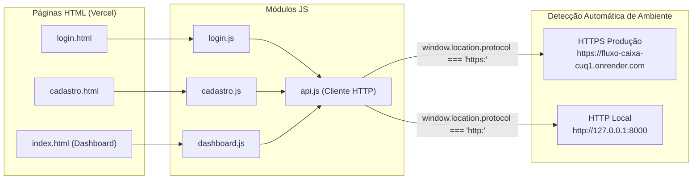

# 🖥️ Frontend — Fluxo de Caixa

> 🌐 **Aplicação Online (Vercel):** [https://fluxo-caixa-coral-two.vercel.app](https://fluxo-caixa-coral-two.vercel.app)

Interface web estática, rápida e responsiva do **Sistema de Fluxo de Caixa**, construída com **HTML5, CSS3, JavaScript Vanilla (ES6+)** e **Chart.js**, hospedada na **Vercel**.

---

## 🎯 Arquitetura de Comunicação da Interface



---

## 📁 Estrutura de Arquivos

```text
frontend/
├── css/
│   └── style.css            # Folha de estilos completa (layout, cards, tabelas, gráficos e modais)
├── js/
│   ├── api.js               # Cliente Fetch centralizado, gestão de JWT e detecção de URL da API
│   ├── cadastro.js          # Máscara de CPF/telefone, validação de senha e criação de conta
│   ├── dashboard.js         # Estado do painel, gráficos Chart.js, filtros, modais e exportação CSV
│   └── login.js             # Submissão OAuth2 (form-urlencoded) e redirecionamento seguro
├── index.html               # Dashboard principal autenticado
├── login.html               # Tela de login
├── cadastro.html            # Tela de cadastro de usuário
└── README.md                # Documentação do frontend
```

---

## ✨ Recursos da Interface

- **Detecção Inteligente de Backend (`api.js`):**
  - Quando acessado via **HTTPS** (na Vercel), conecta automaticamente ao backend de produção no Render (`https://fluxo-caixa-cuq1.onrender.com`).
  - Quando acessado via **HTTP** (`127.0.0.1:5500` ou `127.0.0.1:5173`), conecta automaticamente ao backend local (`http://127.0.0.1:8000`).
  - Permite sobrescrita opcional via `localStorage.setItem("fluxo_caixa_api_url", "...")` ou `window.__API_URL__`.
- **Gráficos Interativos (Chart.js):**
  - Evolução temporal de entradas, saídas e saldo líquido.
  - Distribuição percentual de despesas por categoria.
- **Exportação de Extrato (CSV):** Download imediato das movimentações filtradas em formato compatível com Excel/Google Sheets.
- **Gestão de Sessão Segura:** Token JWT armazenado em `sessionStorage` (`fluxo_caixa_token`) com limpeza automática e redirecionamento em caso de expiração (`HTTP 401`).

---

## 🚀 Como Executar Localmente

### Opção 1 — VS Code Live Server (Porta 5500)
Clique com o botão direito em [`login.html`](login.html) e selecione **"Open with Live Server"** (`http://127.0.0.1:5500/frontend/login.html`).

### Opção 2 — Servidor HTTP do Python (Porta 5173)
Na raiz do projeto:
```powershell
python -m http.server 5173 --bind 127.0.0.1 --directory frontend
```
Acesse `http://127.0.0.1:5173/login.html`.
