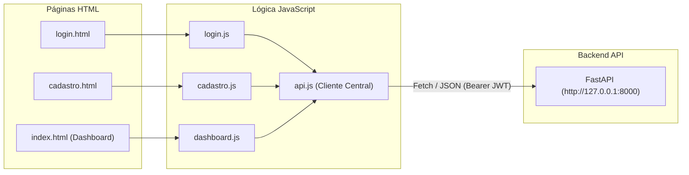

# 🖥️ Frontend — Fluxo de Caixa

Interface web estática, leve e responsiva do **Sistema de Fluxo de Caixa**, desenvolvida com **HTML5, CSS3 e JavaScript Vanilla** (sem frameworks pesados).

---

## 🎯 Arquitetura da Interface



---

## 📁 Estrutura de Arquivos

```text
frontend/
├── css/
│   └── style.css            # Folha de estilos unificada, variáveis CSS e temas
├── js/
│   ├── api.js               # Cliente HTTP compartilhado com fetch, sessionStorage e logs
│   ├── cadastro.js          # Validações de confirmação de senha, CPF e submissão
│   ├── dashboard.js         # Carregamento de contas, extrato, modais dinâmicos e métricas
│   └── login.js             # Envio do formulário OAuth2 e armazenamento do JWT
├── index.html               # Painel principal autenticado
├── login.html               # Tela de autenticação com e-mail e senha
├── cadastro.html            # Tela de criação de nova conta
└── README.md                # Este documento
```

---

## 🚀 Como Executar o Frontend

Certifique-se de que a API backend já esteja em execução em `http://127.0.0.1:8000`.

### Opção 1 — Live Server do VS Code (Recomendado)
1. Instale a extensão **Live Server** no VS Code.
2. Clique com o botão direito em `frontend/login.html` e selecione **"Open with Live Server"**.
3. O navegador abrirá automaticamente em:
   `http://127.0.0.1:5500/frontend/login.html`

> 💡 **Nota:** A porta `5500` já está inclusa por padrão nas origens aceitas pelo CORS do backend!

### Opção 2 — Servidor Python Local (Porta 5173)
Em um terminal dedicado:

```powershell
Set-Location frontend
..\.venv\Scripts\python.exe -m http.server 5173 --bind 127.0.0.1
```

Acesse: [http://127.0.0.1:5173/login.html](http://127.0.0.1:5173/login.html).

---

## 🔐 Gerenciamento de Sessão e Token

1. **Armazenamento:** O token JWT de acesso retornado no login é mantido no `sessionStorage` do navegador sob a chave `fluxo_caixa_token`.
2. **Injeção Automática:** Todas as requisições autenticadas feitas pelo `api.js` injetam o cabeçalho:
   ```http
   Authorization: Bearer <token>
   ```
3. **Expiração e Logout:** Caso o backend responda com **HTTP 401 (Não Autorizado)**, o `api.js` limpa automaticamente o token do `sessionStorage` e solicita um novo login ao usuário.
4. **Log de Diagnóstico:** Todas as falhas de rede no `api.js` emitem detalhes informativos no console do navegador (`F12 -> Console`) para facilitar o diagnóstico de desenvolvimento.
